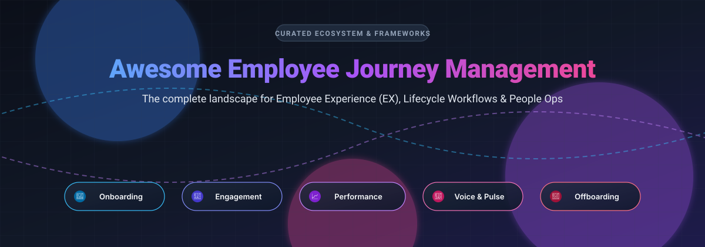

<p align="center">
  
</p>

# 🚀 Awesome Employee Journey Management

<p align="center">
  <a href="https://github.com/ishandutta2007/Awesome-Awesome-Awesome"></a>
  <a href="https://discord.gg/jc4xtF58Ve"></a>
  <a href="https://github.com/ishandutta2007/Awesome-Awesome-Awesome"></a>
  <a href="https://github.com/ishandutta2007/Awesome-Employee-Journey-Management/stargazers"></a>
  <a href="https://github.com/ishandutta2007/Awesome-Employee-Journey-Management/network/members"></a>
  <a href="https://github.com/ishandutta2007"></a>
</p>

> 🌟 A curated directory of battle-tested software, SaaS platforms, open-source tools, frameworks, and best practices for **Employee Journey Management (EJM)**, **Employee Experience (EX)**, and **People Operations Workflows**—from talent attraction and onboarding to continuous engagement, performance growth, and alumni offboarding.

---

## 📑 Table of Contents

- [📊 Sector Overview & Market Dynamics](#-sector-overview--market-dynamics)
- [💼 SaaS Products](#-saas-products)
- [🔓 Open-Source Solutions](#-open-source-solutions)
- [🗺️ Key Stages of the Employee Journey](#️-key-stages-of-the-employee-journey)
- [📈 Star History](#--star-history)
- [💖 Support & Sponsor](#-support--sponsor)
- [🤝 Contributing](#-contributing)
- [📜 License](#-license)

---

## 📊 Sector Overview & Market Dynamics

The global Employee Experience Management (EXM) and Employee Journey Management market is currently estimated at **$6.4B – $7.9B** and is projected to reach over **$15B – $20B** by 2032 at an annual compound growth rate (CAGR) of **9% – 11%**. 

The sector is **moderately to highly fragmented** rather than a winner-take-all monopoly:
- 🏢 **Enterprise HCM Behemoths** (Microsoft Viva, ServiceNow, Workday, SAP SuccessFactors) anchor foundation-level lifecycle workflows and cross-departmental operations.
- 🎯 **Dedicated Listening & Performance Specialists** (Qualtrics, Culture Amp, Lattice, 15Five) lead innovation across pulse surveys, manager 1-on-1s, and career progression pathways.
- 🛠️ **Open-Source & Self-Hosted Platforms** offer privacy-first, custom alternatives for compliance-sensitive organizations avoiding vendor lock-in.

---

## 💼 SaaS Products

The following employee experience and journey management platforms are sorted by company scale (**Market Capitalization / Company Valuation**, descending).

| 🏢 Product | 💰 Valuation / Scale | 🏷️ Starting Pricing | 🎁 Free Tier Limits / Trial | 🎯 Primary Focus |
| :--- | :--- | :--- | :--- | :--- |
| [**ServiceNow HRSD & EJM**](https://www.servicenow.com/products/employee-journey-management.html) | ~$160 Billion *(Market Cap)* | ~$60.00 / agent / month *(Custom enterprise contract, billed annually)* | Free trial only *(Custom guided demo/PoC via sales representative; developer sandboxes available on ServiceNow Developer Program)* | End-to-end multi-departmental employee journey orchestration & HR service delivery workflows |
| [**Microsoft Viva (Viva Glint)**](https://www.microsoft.com/en-us/microsoft-viva/glint) | ~$3.1 Trillion *(Parent: MSFT)* | $2.00 / user / month *(Billed annually; Microsoft 365 prerequisite)* | Free trial only *(90-day free trial up to 50 user seats, provisioned via Microsoft 365 admin center or representative)* | AI-powered employee voice, sentiment listening, and lifecycle pulse analytics |
| [**Workday Peakon Employee Voice**](https://www.workday.com/en-us/products/employee-voice/overview.html) | ~$55 Billion *(Market Cap)* | ~$4.00 – $6.00 / user / month *(Estimated entry spend ~$20,000/year minimum contract)* | Free trial only *(No self-serve free trial; custom 14-day assisted proof of concept through enterprise sales)* | Continuous employee listening, real-time sentiment scoring, and executive benchmark analytics |
| [**Qualtrics EmployeeXM**](https://www.qualtrics.com/experience-management/employee/) | ~$12.5 Billion *(Acquired by Silver Lake)* | ~$4.17 / user / month *(Entry plans start around ~$5,000/year base contract)* | Free forever plan with limits *(Qualtrics Free Account: 1 active survey, 100 responses/survey, 8 question types; advanced EmployeeXM lifecycle features require paid plan or sales trial)* | Comprehensive 360 feedback, employee lifecycle pulse tracking, and engagement analytics |
| [**Lattice**](https://lattice.com/) | $3.0 Billion *(Series F Valuation)* | $4.00 / seat / month *(Engagement or Grow standalone; $11.00/seat/mo for Performance suite)* | Free trial only *(No self-serve free plan; offers interactive product tour and structured sales-assisted sandbox demo)* | Performance management, OKR tracking, continuous check-ins, and employee career paths |
| [**Culture Amp**](https://www.cultureamp.com/) | $1.5 Billion *(Valuation)* | $5.00 / employee / month *(Entry Develop module; ~$23,000 median annual spend for multi-product suite)* | Free trial only *(No permanent free tier; guided interactive demo or structured sales-led evaluation upon request)* | Culture analytics, employee engagement benchmarks, 180°/360° feedback, and turnover prevention |
| [**15Five**](https://www.15five.com/) | ~$130 Million *(Estimated valuation / ~$100M ARR)* | $4.00 / user / month *(Engage plan; $11.00/user/mo for Perform plan, billed annually)* | Free trial only *(14-day fully featured free trial with full access to check-ins, 1-on-1s, and pulse surveys; no credit card required)* | Weekly check-ins, employee pulse surveys, OKR management, and manager coaching tools |

---

## 🔓 Open-Source Solutions

Self-hosted, transparent, and extensible open-source platforms for tracking the employee lifecycle, from recruitment and onboarding to continuous appraisal and exit workflows.

Sorted by GitHub Stars (descending):

| 📦 Repository | ⭐ Stars | 📜 License | 💻 Tech Stack | ⚡ Key Capabilities |
| :--- | :--- | :--- | :--- | :--- |
| [**Frappe HR**](https://github.com/frappe/hrms) | [](https://github.com/frappe/hrms/stargazers) | GPL-3.0 | Python / Frappe / Vue | Complete employee lifecycle management: job applicant tracking, onboarding checklists, transfers, promotions, goal tracking, and exit surveys. |
| [**Horilla**](https://github.com/horilla/horilla-hr) | [](https://github.com/horilla/horilla-hr/stargazers) | LGPL-3.0 | Python / Django | Modern open-source HRMS delivering onboarding flows, employee directories, shift tracking, and performance appraisal milestones. |
| [**OrangeHRM**](https://github.com/orangehrm/orangehrm) | [](https://github.com/orangehrm/orangehrm/stargazers) | GPL-2.0 | PHP / Symfony | Battle-tested personnel management suite featuring recruitment pipelines, employee records, time & attendance, and appraisal reviews. |
| [**ChiefOnboarding**](https://github.com/chiefonboarding/ChiefOnboarding) | [](https://github.com/chiefonboarding/ChiefOnboarding/stargazers) | AGPL-3.0 | Python / Django / Vue | Dedicated employee onboarding platform featuring sequence timelines, pre-boarding courses, automated welcome tasks, and Slack/Teams bot integration. |
| [**CohortHarbor**](https://github.com/lantingzhang1119/cohort-harbor) | [](https://github.com/lantingzhang1119/cohort-harbor/stargazers) | MIT | TypeScript / Next.js | Modern self-hosted employee onboarding hub for internal training modules, document acknowledgment, and new hire assessment workflows. |
| [**OpenHRApp**](https://github.com/mimnets/OpenHRApp) | [](https://github.com/mimnets/OpenHRApp/stargazers) | MIT | React / TypeScript / Supabase | Lightweight self-hosted employee directory, attendance tracking, and peer performance evaluation platform for small-to-midsize businesses. |

---

## 🗺️ Key Stages of the Employee Journey

```
  [ Attract & Hire ]
          │
          ▼
   [ Pre-Boarding ] ──► Welcome packet, paperwork, device provisioning
          │
          ▼
    [ Onboarding ]  ──► First 30-60-90 days, buddy system, team rituals
          │
          ▼
  [ Growth & Dev ]  ──► 1-on-1 check-ins, OKRs/goals, continuous feedback
          │
          ▼
    [ Retention ]   ──► Engagement pulses, peer rewards, internal mobility
          │
          ▼
   [ Offboarding ]  ──► Exit interviews, alumni network, access revocation
```

---

## 📈 Star History

[](https://star-history.dera.page/#ishandutta2007/Awesome-Employee-Journey-Management&type=date&legend=top-left)

---

## 💖 Support & Sponsor

Thank you for visiting and using this curated list! Maintaining open-source resources and industry landscape maps takes continuous time, testing, and research. 

If you found this repository helpful, please consider:
- ⭐ **Starring** the repository to boost visibility
- 🍴 **Forking** and contributing new tools or corrections
- 📢 **Sharing** this guide with colleagues, HR professionals, and People Ops leaders
- ☕ **Buying a coffee or becoming a sponsor** to fuel ongoing updates:
  
👉 [**Sponsor via GitHub Sponsors Dashboard**](https://github.com/sponsors/ishandutta2007)

---

## 🤝 Contributing

Contributions are warmly welcome! To submit a new tool, framework, or update:
1. Ensure the project explicitly covers one or more stages of the employee journey (onboarding, lifecycle workflows, feedback, retention, or offboarding).
2. For SaaS tools, provide verifiable starting pricing and explicit free tier or trial conditions.
3. For open-source tools, include the repository link, software license, and tech stack.
4. Follow the existing tabular structure and styling.

---

## 📜 License

[](https://creativecommons.org/publicdomain/zero/1.0/)

To the extent possible under law, the authors have waived all copyright and related or neighboring rights to this work.
